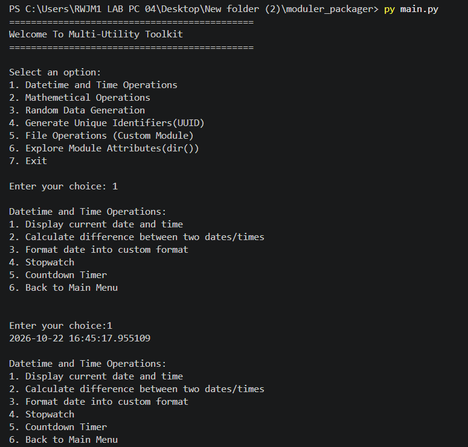

# Multi-Utility Toolkit

## Subtitle of the Project

A simple Python project that performs datetime operations, mathematical calculations, random data generation, UUID generation, file handling, and module exploration using custom Python modules.

## About the Project

This project is a beginner-friendly Python program that provides an interactive, menu-driven interface to perform multiple utility operations.

The program allows the user to select from the following options:

* Perform datetime and time operations.
* Perform mathematical calculations.
* Generate random numbers, lists, passwords, and OTPs.
* Generate unique identifiers using UUID.
* Perform file operations using a custom module.
* Explore module attributes using the `dir()` function.
* Exit the program.

The project is organized into separate Python modules inside the `packages` folder. The `main.py` file acts as the main entry point and imports functions from these modules.

The program uses Python's built-in modules, such as `datetime`, `time`, `math`, `random`, `string`, and `uuid`, along with custom modules for file operations and module exploration.

The program continues displaying the main menu until the user chooses the Exit option.

## Output



## Features

* Displays an interactive main menu.
* Organizes the program into separate Python modules.
* Displays the current date and time.
* Calculates the difference between two dates.
* Formats dates and times into different formats.
* Provides a stopwatch functionality.
* Provides a countdown timer.
* Calculates the factorial of a number.
* Calculates compound interest.
* Performs trigonometric calculations using sine and cosine.
* Calculates the area of a circle and a rectangle.
* Generates random numbers.
* Shuffles a predefined list of numbers.
* Generates random passwords.
* Generates random OTPs.
* Generates unique identifiers using UUID.
* Creates new text files.
* Writes data to files.
* Reads file contents.
* Appends data to existing files.
* Updates existing text in files.
* Explores attributes of Python modules using `dir()`.
* Uses exception handling with `try` and `except` in file operations.
* Uses functions to organize different operations.
* Uses loops and conditional statements to manage menu selections.
* Allows the user to return to the main menu or exit the program.

## Concepts Used

* Variables and data types.
* User input and output.
* Type conversion using `int()` and `float()`.
* Functions and function calls.
* Modules and packages.
* Importing functions from custom modules.
* The `datetime` module.
* The `time` module.
* The `math` module.
* The `random` module.
* The `string` module.
* The `uuid` module.
* Date and time formatting using `strftime()`.
* Date parsing using `strptime()`.
* Calculating differences between dates.
* Measuring elapsed time.
* Countdown using `while` loops.
* Mathematical calculations.
* Random data generation.
* File handling.
* File modes such as `x`, `w`, `r`, and `a`.
* Reading and writing text files.
* Exception handling using `try` and `except`.
* Conditional statements using `if`, `elif`, and `else`.
* `while` loops.
* The `dir()` function.
* Menu-driven programming.
* Modular programming and code reusability.

## Built-in Functions and Methods Used

* `print()`
* `input()`
* `int()`
* `float()`
* `open()`
* `strptime()`
* `strftime()`
* `now()`
* `time()`
* `sleep()`
* `factorial()`
* `radians()`
* `sin()`
* `cos()`
* `shuffle()`
* `randint()`
* `randrange()`
* `choices()`
* `join()`
* `dir()`
* `break`

## Technology Used

* Python
* Visual Studio Code (VS Code)
* Git
* GitHub

## How to Run

### Step 1: Install Python

Download and install Python from the official website:
```bash
https://www.python.org/downloads/
```

### Step 2: Open the Project

Open the project folder `moduler_packager` in Visual Studio Code.

### Step 3: Run the Program

Open the terminal in the project directory and execute:

```bash
python main.py
```

## Project Structure

```text
│
├── packages/
│   ├── __init__.py
│   ├── explore_module.py
│   ├── file_utils.py
│   └── math_utils.py
│
├── main.py
├── output.png
└── README.md
```

## Learning Objectives

By completing this project, you can learn:

* How to create and use Python modules and packages.
* How to divide a large program into smaller, reusable modules.
* How to import functions from custom modules.
* How to use Python's built-in modules.
* How to perform date and time operations.
* How to calculate differences between dates.
* How to use the `math` module for mathematical calculations.
* How to generate random numbers, passwords, and OTPs.
* How to generate unique identifiers using UUID.
* How to create, read, write, append, and update text files.
* How to handle file-related exceptions.
* How to explore module attributes using `dir()`.
* How to use loops and conditional statements.
* How to create a menu-driven application.
* How to organize code for better readability and reusability.
* How to manage a Python project using VS Code, Git, and GitHub.

## Author
**GAURAV VERMA**